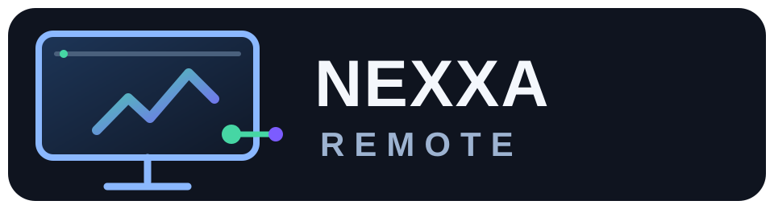
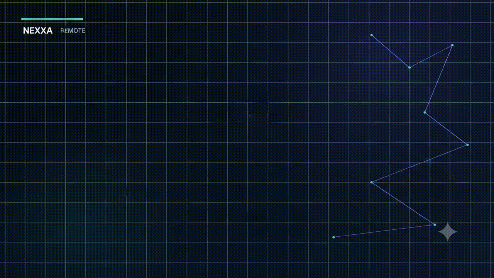

<p align="center">
  
</p>

<p align="center">
  <strong>A Windows-first, self-hosted remote desktop over your private Tailscale network.</strong>
</p>

<p align="center">
  <a href="https://github.com/technomaxxa/Nexxa-Remote"></a>
  
  
  
  <a href="LICENSE"></a>
  
</p>

---

## What is Nexxa Remote?

**Nexxa Remote** is a Windows-first remote desktop application written in Java Swing. It lets a user view and, with the host's explicit permission, control another Windows computer over a private Tailscale network.

Nexxa does not operate a public rendezvous or relay service. Each computer joins the user's Tailscale network, and the Nexxa host listens on its Tailscale IPv4 address. This avoids exposing the Nexxa listening port to the public Internet and normally avoids router port-forwarding.

The project is released under the MIT License. Nexxa itself has no subscription, session timer, or account system. **Tailscale is a separate third-party service** and its software, account requirements, availability, and plan limits are governed by Tailscale—not by this project.

## Watch the 45-second demo

<p align="center">
  <a href="https://www.youtube.com/watch?v=2znw9T87pUg">
    
  </a>
</p>

> **Project status: beta / experimental.** Remote desktop software is security-sensitive. The current implementation has not undergone an independent security audit and has only been exercised with local automated tests in the development environment. Test it on trusted devices before relying on it. Do not expose its TCP port directly to the public Internet.

## Features

| Feature | Current implementation |
|---|---|
| Remote screen | Full-screen desktop capture sent as JPEG frames over TLS/TCP |
| Remote input | Host-approved mouse, keyboard, and wheel input |
| Host input priority | Physical host input temporarily takes priority over remote input when the Windows hook is healthy |
| Connection security | TLS 1.2/1.3, host-certificate SHA-256 pinning, and a random per-session access key |
| Invitations | Copyable `nexxa://` invitation containing host address, port, certificate fingerprint, and session key |
| Clipboard | Optional plain-text synchronization in both directions |
| Desktop audio | Experimental; requires a Windows recording endpoint such as Stereo Mix / What U Hear |
| Video profiles | Low latency, Balanced, High quality (Full HD), and Ultra detail (up to 1440p) |
| Tailscale devices | Shows device names and Tailscale IP addresses visible to the signed-in account |
| Cross-account access | Supported after the host device is shared from Tailscale and the recipient accepts |
| Administrator mode | Host-side UAC elevation; it does not bypass Windows UAC or secure-desktop prompts |
| Link handling | Optional per-user Windows registration for `nexxa://` links |
| Concurrent viewers | One active viewer per host in this version |

### Video profiles

The host selects the profile before starting a session. The dimensions are maximum bounds; smaller host displays are not upscaled.

| Profile | Maximum frame size | JPEG quality | Target frame rate |
|---|---:|---:|---:|
| Low latency | 1024 × 576 | 0.48 | 20 FPS |
| Balanced | 1600 × 900 | 0.66 | 18 FPS |
| High quality | 1920 × 1080 | 0.86 | 12 FPS |
| Ultra detail | 2560 × 1440 | 0.92 | 8 FPS |

The frame rates are targets, not guarantees. Actual performance depends on host capture speed, CPU, display dimensions, Tailscale route, and network capacity. This release sends full-frame JPEG over TLS/TCP; hardware H.264, dirty-region encoding, and UDP video transport are not included.

## How Nexxa works

```text
                    Tailscale private network

  HOST PC                                               VIEWER PC
  ┌──────────────────────────┐                          ┌──────────────────────────┐
  │ Nexxa Host               │                          │ Nexxa Viewer             │
  │                          │                          │                          │
  │ Screen capture           │── TLS/TCP: JPEG frames ─▶│ Frame decoder / display  │
  │ JPEG encoder             │                          │                          │
  │                          │◀─ TLS/TCP: input events ──│ Mouse / keyboard events  │
  │ Host input arbitration   │                          │                          │
  │ Clipboard / optional     │◀──── Text clipboard ────▶│ Clipboard / audio        │
  │ audio capture            │                          │ playback                 │
  └─────────────┬────────────┘                          └──────────────────────────┘
                │
                └── Listens on the host's Tailscale IPv4 address
```

1. Both PCs run the Tailscale client and are connected to the same tailnet, or the host device has been shared with the viewer's Tailscale account.
2. The host creates or loads its persistent TLS identity, generates a random session access key, and starts a TLS listener on its Tailscale IPv4 address.
3. Nexxa creates an invitation link containing the host's Tailscale address, TCP port, SHA-256 certificate fingerprint, and temporary access key.
4. The viewer opens or pastes that invitation. It pins the host certificate fingerprint, negotiates TLS, and submits the session key.
5. After authentication, the host streams screen frames and cursor position. Input, clipboard, and audio permissions remain controlled by the host.

Nexxa does not run its own Internet relay. Tailscale handles connectivity between the devices, including its own direct-connection and encrypted relay mechanisms where needed. See [Tailscale's documentation](https://tailscale.com/kb/) for details about its network behavior.

## Requirements

### To run Nexxa

- Windows 10 or Windows 11, 64-bit.
- Tailscale for Windows installed and signed in on each computer.
- Internet access on first launch so the launcher can download the private Java runtime.
- No system-wide Java installation is required. Nexxa uses `runtime\bin\javaw.exe` from its own folder.

The launcher first downloads the pinned Eclipse Temurin JRE 25.0.5+8 Windows x64 archive and verifies its SHA-256 checksum. If that download, checksum, extraction, or runtime check fails, it tries the official Oracle JDK 25 Windows x64 archive and verifies the checksum published by Oracle. The runtime is stored under `runtime\`; it does not modify `PATH` or replace another Java installation. Runtime downloads are governed by their own licenses; read [THIRD-PARTY-NOTICES.md](THIRD-PARTY-NOTICES.md).

### To build or modify Nexxa

- JDK 21 or newer (the source is compiled with `--release 21`).
- Windows PowerShell and the standard Windows command-line tools.
- Git, if you are cloning or contributing to the repository.

Nexxa uses Java platform APIs and has no third-party Java library dependency.

## Quick start on Windows

1. Download the latest Nexxa Remote ZIP from the repository's [Releases](https://github.com/technomaxxa/Nexxa-Remote/releases) page (or clone the repository and use the files in its root).
2. Extract the ZIP to a normal user-writable folder, for example `Documents\NexxaRemote`. Do not extract it into a temporary folder.
3. Install and sign in to [Tailscale for Windows](https://tailscale.com/download/windows) on both computers.
4. Double-click **`Start Nexxa Remote.bat`**. On first launch, allow the runtime installer to download and verify Java 25. Later starts reuse the private runtime.
5. On the host, open **Share this PC**, check the permissions you want to grant, select a streaming profile, and click **Start sharing**.
6. Copy the invitation link and send it privately to the viewer. Treat this invitation like a password.
7. On the viewer, open **Connect**, paste the invitation, choose the features to request, and connect.
8. The host must enable remote keyboard/mouse control before the viewer can control the host. The host can stop sharing at any time to revoke the session invitation.

Both host and viewer should use the same Nexxa version. This repository currently describes v0.7.5.

## Connecting people on different Tailscale accounts

Nexxa does not merge or administer Tailscale accounts. To connect a viewer from another account:

1. The host signs in to the [Tailscale Admin Console](https://login.tailscale.com/admin/machines).
2. The host shares the host computer with the viewer's Tailscale account using Tailscale's device-sharing feature.
3. The viewer accepts the share and signs in to their own Tailscale account.
4. Confirm that the shared host device is reachable from the viewer PC.
5. Send the Nexxa invitation privately and connect as usual.

Read Tailscale's current [device-sharing documentation](https://tailscale.com/kb/1084/sharing/) and account/plan terms before using cross-account sharing.

## Windows helper scripts

| File | Purpose |
|---|---|
| `Start Nexxa Remote.bat` | Starts Nexxa using the private Java 25 runtime; provisions it on first launch |
| `Install-Bundled-Runtime.ps1` | Downloads and verifies Temurin, with Oracle JDK fallback |
| `Build Nexxa Remote.bat` | Compiles `NexxaRemote.java` and creates `NexxaRemote.jar` using a JDK |
| `Run Self-Test.bat` | Runs the built-in headless self-test |
| `Build Offline Full Bundle.bat` | After runtime setup, creates a ZIP containing Nexxa and the private runtime |
| `Register Nexxa Link Handler.bat` | Registers `nexxa://` links for the current Windows user |
| `Unregister Nexxa Link Handler.bat` | Removes that per-user `nexxa://` association |

### Register and unregister `nexxa://` links

Registration is optional. Copy/paste invitations work without it.

- Run **`Register Nexxa Link Handler.bat`** to register `nexxa://` with Windows for the current user (`HKCU`). If Windows asks, allow the script to provision the private runtime first.
- Run **`Unregister Nexxa Link Handler.bat`** to remove the association.
- If you move the Nexxa folder after registering, unregister the old path and register it again from the new folder.

This association is per-user, not machine-wide. The scripts do not register a system-wide protocol handler.

## Build from source

See [docs/BUILDING.md](docs/BUILDING.md) for detailed instructions. The short version on Windows is:

```bat
javac --release 21 -encoding UTF-8 -Xlint:all -d build NexxaRemote.java
jar --create --file NexxaRemote.jar --manifest manifest.mf -C build .
```

Then run the self-test:

```bat
java -Djava.awt.headless=true -jar NexxaRemote.jar --self-test
```

Or use **`Build Nexxa Remote.bat`** and **`Run Self-Test.bat`**.

## Modify the project

The main implementation currently lives in one source file, `NexxaRemote.java`.

| Area | Search in `NexxaRemote.java` | What it controls |
|---|---|---|
| App identity | `APP_NAME`, `APP_VERSION`, `DEFAULT_PORT` | Window name, release version, default host port |
| Stream profiles | `record StreamProfile` | Resolution bounds, FPS targets, JPEG quality |
| JPEG encoding | `class JpegEncoder` | Downsampling and JPEG encoding |
| Invitations | `createInvite`, `parseInvite` | `nexxa://` invitation structure |
| TLS / identity | `IdentityStore`, `createServerContext`, `createPinnedClientContext` | Persistent certificate, TLS, certificate pinning |
| Tailscale integration | `class TailscaleManager` | CLI discovery, status, peers, service lifecycle, firewall helper |
| Host UI | `class HostPanel` | Sharing controls, devices, settings, host activity console |
| Host networking | `class HostServer` | TLS listener, authentication, streaming, input, clipboard, audio |
| Viewer UI / networking | `class ViewerPanel` | Invitation input, connection, frame decoder, input sender |
| Screen display | `class ScreenPanel` | Aspect-ratio-preserving Fit rendering and remote cursor |
| Host input priority | `LocalInputMonitor`, `NexxaPhysicalInputHooks` | Windows physical-input detection and arbitration |
| Audio | `class AudioLine` | Experimental recording and playback endpoints |
| Tests | `runSelfTests` | TLS, invitations, image encoding, fit geometry, peer parsing, input-priority checks |

After modifying source, rebuild the JAR and run the self-test. For protocol changes, update both host and viewer together; mixed versions may not interoperate.

## Data, privacy, and security

- Nexxa's host listener is bound to the host's Tailscale IPv4 address. Do not expose the port on a public interface or configure public port forwarding for this version.
- Nexxa uses TLS 1.2/1.3 and the invitation's SHA-256 certificate pin to authenticate the host. The invitation also contains a random session access key.
- An invitation is a bearer secret. Anyone who obtains it may attempt to connect until the host stops sharing or otherwise invalidates that invitation. Never commit real invitation URLs to Git, issue trackers, screenshots, chat logs, or public documentation.
- The persistent host private key and its protected password are stored in the current Windows user's application-data folder (`%APPDATA%\NexxaRemote`). The password is protected with Windows DPAPI. Do not share or commit that folder.
- Clipboard synchronization transfers plain text only and is opt-in. Avoid enabling it for confidential material unless the remote viewer is trusted.
- Desktop audio is opt-in and experimental. Java Sound can only capture an endpoint Windows exposes as a supported recording device (for example, Stereo Mix / What U Hear). A microphone is not desktop loopback.
- Administrator mode uses normal Windows UAC elevation. It does not bypass UAC, secure-desktop prompts, credential dialogs, or application-specific security restrictions. Only enable it for a trusted viewer.
- Nexxa does not include a Nexxa-operated analytics service or public relay in this version. Tailscale is a separate service and may process its own account, device, connection, and network metadata under its own privacy policy.

Read [SECURITY.md](SECURITY.md), [docs/SECURITY.md](docs/SECURITY.md), and [docs/PRIVACY.md](docs/PRIVACY.md) before using Nexxa with sensitive systems.

## Known limitations

- Windows is the supported desktop platform. Some operations use Windows PowerShell, Windows service management, DPAPI, and Win32 low-level input hooks.
- One active viewer per host.
- Tailscale is required; Nexxa does not provide a public relay or account coordination service.
- Video is full-frame JPEG over TLS/TCP. There is no hardware H.264 encoder or UDP video transport in this release.
- Audio capture is experimental and depends on a loopback-capable recording endpoint being exposed to Java Sound.
- Clipboard sync supports plain text, not file transfer.
- Windows secure-desktop UAC prompts require local interaction.
- Physical host-input priority relies on Windows low-level hooks. If the hook cannot start, Nexxa reports degraded arbitration; remote control may remain available without guaranteed host-over-remote priority.
- This release has not received an independent security audit.

## Repository layout

```text
Nexxa-Remote/
├── assets/                 # README logo and project artwork
├── docs/                   # Architecture, networking, build, privacy, security
├── .github/                # Issue templates and CI workflow
├── NexxaRemote.java        # Application source
├── NexxaRemote.jar         # Convenience build of the current source
├── manifest.mf             # JAR manifest
├── Start Nexxa Remote.bat  # Windows launcher
├── Build Nexxa Remote.bat  # Source build script
├── Install-Bundled-Runtime.ps1
├── Register/Unregister Nexxa Link Handler scripts
├── LICENSE                 # MIT license
└── README.md
```

The Java runtime itself, host identity, local settings, build output, and user-specific data are intentionally excluded from Git.

## Contributing

Issues and pull requests are welcome. Please read [CONTRIBUTING.md](CONTRIBUTING.md) first. Do not attach real invitation links, private IP addresses, certificate stores, DPAPI files, passwords, screenshots containing personal data, or Tailscale account details to public issues.

## License

Nexxa Remote's application source is licensed under the [MIT License](LICENSE). Runtime distributions downloaded by the launcher are third-party software and remain subject to their respective notices and licenses; see [THIRD-PARTY-NOTICES.md](THIRD-PARTY-NOTICES.md).
